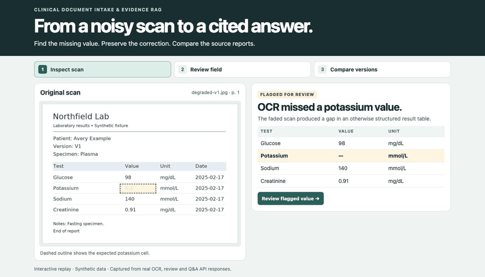

# Clinical Document Intake & Evidence RAG

**Review noisy lab reports and trace each answer to the exact spot on the original scan.** A faded digit can leave a result unreadable. A revised report can give the same test a different value. This app makes both cases visible to the reviewer.

[**Try the interactive demo**](https://mahdibayanloo.github.io/clinical-document-intake-rag/) · [Three screenshots](#walkthrough) · [Run the full app](#run-the-full-app)



## Walkthrough

| Step | What happens |
| --- | --- |
| [1. Inspect the scan](docs/media/01-inspect.jpg) | Tesseract TSV produces a structured result table. The app flags the missed potassium value and highlights its expected location. |
| [2. Review the field](docs/media/02-review.jpg) | A reviewer enters **4.2 mmol/L**. The app keeps the original OCR, source region, and correction history together. |
| [3. Compare versions](docs/media/03-compare.jpg) | The answer shows **4.2 mmol/L in V1** and **5.1 mmol/L in V2**. Both citations jump to their source regions. A reviewer can choose a preferred result. |

The browser demo is an interactive replay built from real OCR and FastAPI responses on synthetic reports. It opens without installation or an API key. The full app accepts new scans and questions.

## Implementation and results

- **Intake and review** use Python, FastAPI, Tesseract word boxes, SQLite, and a React image-and-table editor.
- **Evidence Q&A** uses FTS5 scoped to case and report version. The optional OpenAI-compatible model returns exact statements checked against retrieved citation IDs and numeric values. A labeled extractive mode handles offline use, missing evidence, and conflicts.
- **Verified on synthetic data** with **59/60 fields** matching ground truth before review across three readable reports, zero rows from the unreadable scan, and **13 passing tests**. The browser walkthrough verified the correction and both citation links.

<details>
<summary>Measurements and limits</summary>

One local run on macOS with native Tesseract 5.5.4. Field matches compare the five normalized fields per row against [synthetic ground truth](fixtures/ground-truth.json). Intake stores actual TSV records, OCR text, and bounding boxes separately. The original OCR remains available after review.

| Fixture | Rows | Flagged rows | Field matches | OCR and extraction |
| --- | ---: | ---: | ---: | ---: |
| Clean V1 | 4 | 0 | 20/20 | 0.15 s |
| Degraded V1 | 4 | 2 | 19/20 | 0.15 s |
| Corrected V2 | 4 | 0 | 20/20 | 0.14 s |
| Unreadable | 0 | 0 | — | 0.06 s |

The app handles single-page PNG/JPEG scans in one English four-column layout with a version label such as **V1**. Comparisons group by test name and specimen date. The LLM route was verified with a mock endpoint. The local app has no authentication or encrypted data store. Use synthetic data.

</details>

## Run the full app

Use Python 3.12, Node.js 22.12+, and Tesseract 5 with English language data. On macOS, run `brew install tesseract`. On Ubuntu, install `tesseract-ocr` and `tesseract-ocr-eng`. Python needs SQLite FTS5.

```sh
python3.12 -m venv .venv
source .venv/bin/activate
python -m pip install -r requirements-dev.txt
(cd frontend && npm ci && npm run build)
python -m scripts.seed
python -m uvicorn backend.main:app --host 127.0.0.1 --port 8000
```

Open [the app](http://127.0.0.1:8000) or [API docs](http://127.0.0.1:8000/docs). In **demo-1042**, upload `fixtures/degraded-v1.jpg`, review potassium, and ask **What changed between versions?** For the missing-evidence path, ask **What was the blood type?** or inspect **demo-unreadable**. Ask **What was the specimen?** to see a raw OCR passage citation.

Set `INTAKE_DB` to a fresh path for an independent run, or `TESSERACT_CMD` for a custom executable. To enable the model, set `OPENAI_BASE_URL`, `OPENAI_MODEL`, and `OPENAI_API_KEY`. A localhost model can run without a key. Configured endpoints receive the submitted question and candidate evidence.

```sh
python -m pytest -q
python -m scripts.measure
python -m scripts.build_portfolio
```

The last command builds a self-contained browser replay at `portfolio-build/index.html`. The [GitHub Pages workflow](.github/workflows/pages.yml) publishes that replay. See [publishing instructions](docs/publish.md) to deploy a copy.
